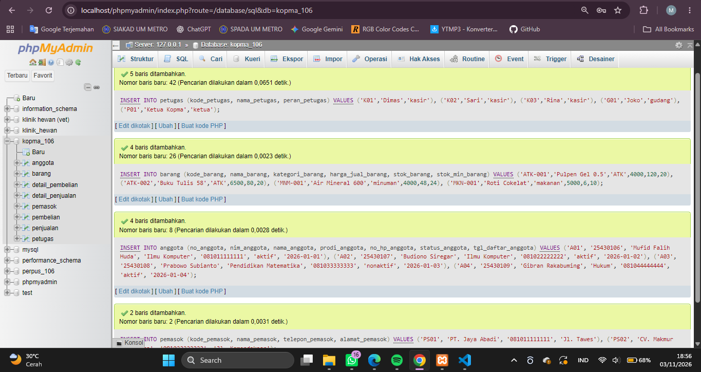
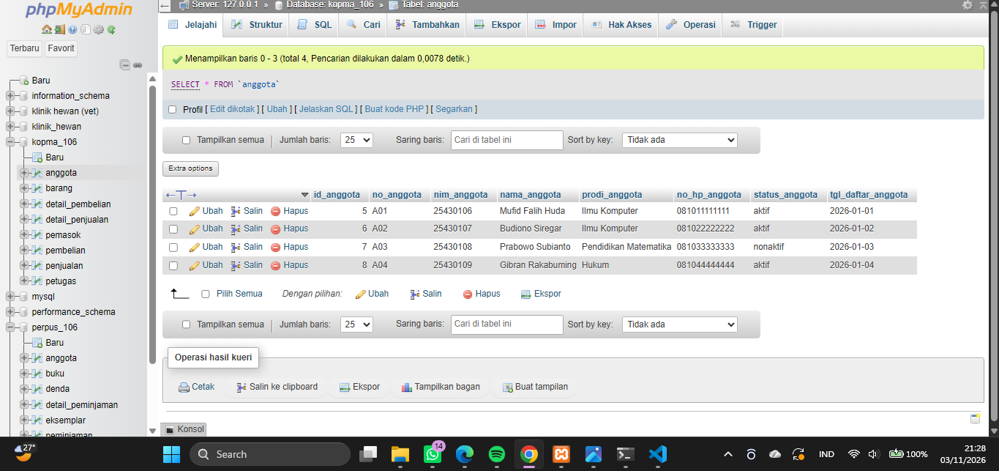
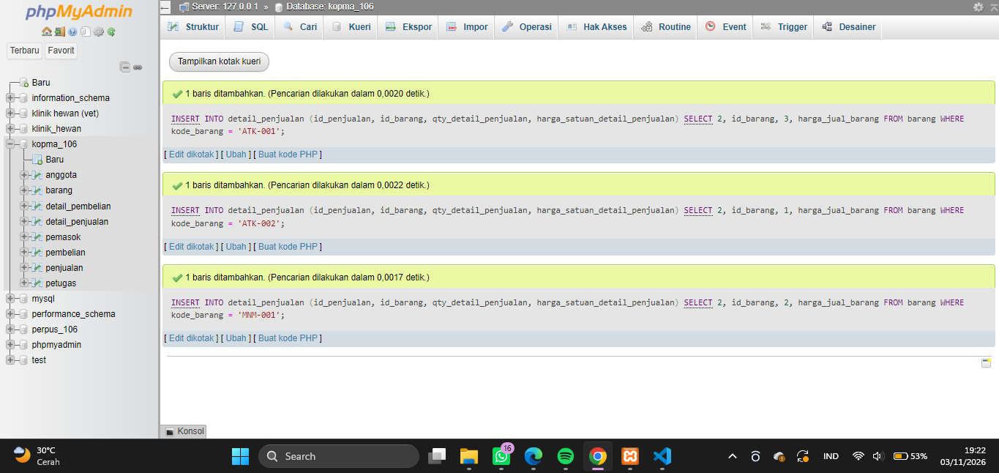
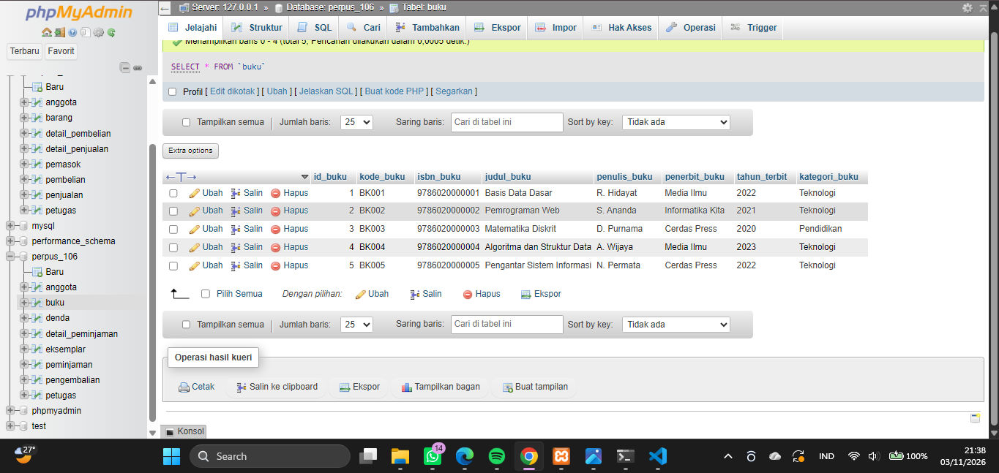
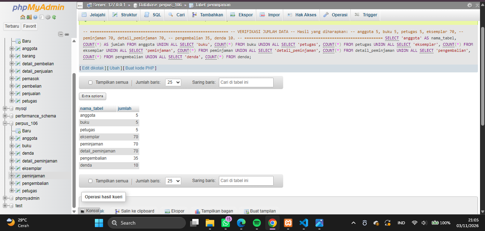
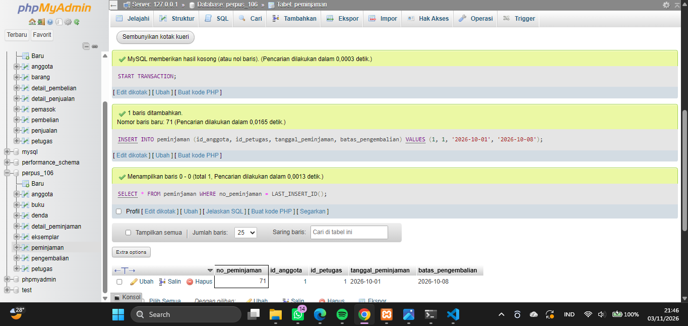
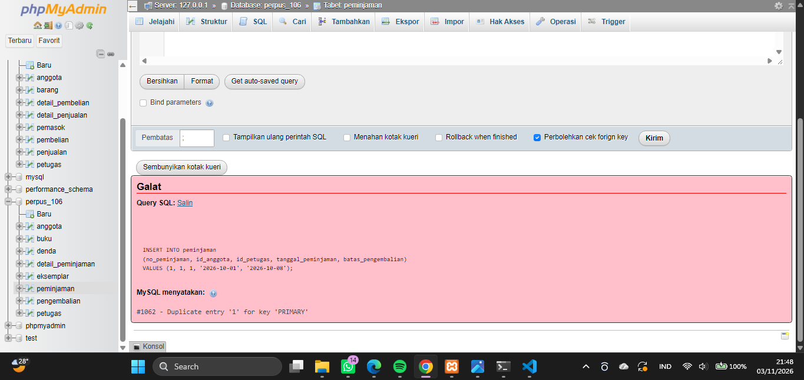

# Laporan Praktikum Basis Data - Pertemuan 06

**Nama:** Mufid Falih Huda 

**NPM:** 25430106 

**Kelas:** D  

**Tanggal:** 3 November 2026

**Dosen:** Dedi Irawan, S.Kom., M.Kom.

## 1. Tujuan Praktikum

Setelah menyelesaikan praktikum ini, mahasiswa diharapkan mampu:

1. Menambahkan data ke dalam tabel menggunakan perintah `INSERT`.
2. Mengubah dan menghapus data menggunakan perintah `UPDATE` dan `DELETE`.
3. Menggunakan mode aman untuk mencegah perubahan data yang tidak disengaja.
4. Melakukan pengujian positif dan negatif terhadap aturan integritas basis data.
5. Menyusun data sampel dan skenario pengujian untuk proyek basis data.

## 2. Ringkasan Dasar Teori

Data Manipulation Language (DML) merupakan bagian dari SQL yang digunakan untuk mengelola isi tabel dalam basis data.

Perintah DML yang digunakan dalam praktikum ini meliputi:

| Perintah | Fungsi |
|---|---|
| `INSERT` | Menambahkan data baru ke dalam tabel. |
| `UPDATE` | Mengubah data yang sudah tersimpan. |
| `DELETE` | Menghapus data dari tabel. |
| `SELECT` | Menampilkan dan memeriksa data. |

Dalam pengelolaan basis data, pengisian data harus memperhatikan hubungan antara tabel induk dan tabel anak melalui Primary Key dan Foreign Key.

Selain itu, pengujian dilakukan melalui dua jenis pengujian, yaitu uji positif untuk memastikan data yang benar diterima dan uji negatif untuk memastikan data yang melanggar aturan ditolak oleh sistem.

## 3. Hasil Langkah Percobaan

### 3.1 Mengisi Data Induk (D.1)

Pada tahap ini dilakukan pengisian data induk pada basis data Kopma menggunakan perintah `INSERT`. Data yang dimasukkan meliputi petugas, barang, anggota, dan pemasok.

Pengisian data dilakukan dengan memperhatikan kebutuhan setiap tabel serta hubungan antartabel.

**Pengisian data induk Kopma**

### 3.2 Mencatat Nota Penjualan (D.2)

Tahap berikutnya adalah membuat transaksi penjualan dengan menggunakan data yang telah dimasukkan sebelumnya.

Pencatatan transaksi dilakukan menggunakan perintah `INSERT` pada tabel penjualan dan `INSERT ... SELECT` pada tabel detail penjualan. Selanjutnya, stok barang diperbarui menggunakan perintah `UPDATE` sesuai jumlah barang yang terjual.

**Pencatatan nota penjualan Kopma**

### 3.3 Mengubah dan Menghapus Data dengan Aman (D.3)

Pada tahap ini digunakan fitur `sql_safe_updates` untuk mencegah perubahan data secara tidak sengaja.

Perintah UPDATE tanpa kondisi yang aman dicoba terlebih dahulu dan seharusnya ditolak oleh sistem. Selanjutnya, perintah UPDATE dengan kondisi `WHERE` yang sesuai dijalankan.

Selain itu, dilakukan pengujian penghapusan nota penjualan untuk melihat penerapan `ON DELETE CASCADE`, serta penghapusan petugas yang masih memiliki transaksi untuk mengetahui bagaimana Foreign Key menjaga integritas data.

### 3.4 Menjalankan Skenario Pengujian (D.4)

Pengujian dilakukan dengan membuat skenario positif dan negatif untuk memastikan aturan pada basis data berjalan sesuai ketentuan.

Setiap skenario dijalankan dengan memasukkan data uji, mengamati hasil yang muncul, kemudian mencatat apakah hasil tersebut sesuai dengan yang diharapkan.

HASIL ADA DI FILE `p06_uji_kopma_25430106.md`

## 4. Jawaban Titik Analisis

### 4.1 Titik Analisis 1

**Mengapa INSERT ... SELECT lebih aman daripada mengetik angka secara manual? Apakah perubahan harga barang akan mengubah harga pada nota sebelumnya?**

`INSERT ... SELECT` lebih aman karena nilai diambil langsung dari tabel sumber sehingga mengurangi kesalahan pengetikan. Perubahan harga barang setelah transaksi tidak akan mengubah harga pada nota sebelumnya karena harga satuan telah disimpan pada tabel detail penjualan.

### 4.2 Titik Analisis 2

**Mengapa menghapus nota dapat menghapus detailnya, sedangkan menghapus petugas ditolak?**

Hal tersebut disebabkan oleh perbedaan aturan Foreign Key. `ON DELETE CASCADE` menyebabkan data detail ikut terhapus ketika data nota dihapus. Sementara itu, penghapusan petugas ditolak karena data petugas masih digunakan oleh transaksi. Jika kasir berhenti bekerja, cara yang lebih tepat adalah mengubah statusnya menjadi tidak aktif, bukan menghapus datanya.

### 4.3 Titik Analisis 3

**Mengapa aturan stok tidak selalu dapat dijaga menggunakan CHECK?**

Constraint CHECK hanya memeriksa nilai pada baris yang sedang dimasukkan atau diubah. CHECK tidak secara otomatis membandingkan jumlah barang yang dijual dengan stok barang yang tersedia pada tabel lain. Oleh karena itu, aturan agar jumlah penjualan tidak melebihi stok memerlukan validasi tambahan.

## 5. Hasil Latihan dan Modifikasi

### 5.1 Pengarsipan Anggota Nonaktif

Latihan ini dilakukan dengan memindahkan anggota yang berstatus nonaktif dan terdaftar sebelum tahun 2025 ke tabel arsip.

Proses dilakukan menggunakan `CREATE TABLE ... LIKE` untuk membuat tabel dengan struktur yang sama, kemudian `INSERT ... SELECT` untuk memindahkan data yang memenuhi kondisi. Setelah dipastikan aman, data dapat dihapus dari tabel asal dengan memperhatikan hubungan transaksi.

### 5.2 Pembaruan Harga Barang

Latihan berikutnya adalah menaikkan harga seluruh barang dalam kategori makanan sebesar 5% dan membulatkannya ke ratusan terdekat.

Perintah UPDATE digunakan dengan kondisi kategori agar perubahan hanya berlaku pada barang makanan.

## 6. Tugas Mandiri: Milestone Proyek 6

### 6.1 Pembuatan Data Sampel Perpustakaan M MEDIA

Pada tugas mandiri ini, materi DML diterapkan pada proyek Perpustakaan M MEDIA dengan nama database `perpus_106`.

Data sampel dibuat menggunakan berkas `p06_data_25430106.sql` yang berisi data untuk delapan tabel, yaitu:

| No. | Nama Tabel | Jumlah Data yang Ditargetkan |
|---:|---|---:|
| 1 | anggota | 5 |
| 2 | buku | 5 |
| 3 | petugas | 5 |
| 4 | eksemplar | 70 |
| 5 | peminjaman | 70 |
| 6 | detail_peminjaman | 70 |
| 7 | pengembalian | 35 |
| 8 | denda | 10 |

Jumlah transaksi utama ditentukan berdasarkan parameter unik:

\[
10 \times P = 10 \times 7 = 70
\]

Dengan demikian, jumlah peminjaman yang dibuat adalah 70 transaksi dan tersebar pada minimal tiga tanggal berbeda.

<!-- SCREENSHOT WAJIB: Tampilkan hasil INSERT atau isi tabel proyek yang menunjukkan data berhasil dimasukkan. -->

### 6.2 Verifikasi Jumlah Data

Setelah proses pengisian selesai, dilakukan verifikasi menggunakan `COUNT(*)` untuk memastikan jumlah data pada setiap tabel sesuai dengan ketentuan.

### 6.3 Verifikasi Distribusi Tanggal Peminjaman

Data peminjaman diperiksa menggunakan `GROUP BY` untuk memastikan transaksi tersebar pada minimal tiga tanggal berbeda.

### 6.4 Skenario Pengujian Proyek

Pengujian proyek disusun dalam berkas `p06_uji_25430106.md` yang berisi minimal sepuluh skenario pengujian, dengan sedikitnya lima pengujian negatif.

Skenario pengujian digunakan untuk memeriksa apakah data yang benar dapat diterima dan data yang melanggar aturan ditolak oleh sistem.

Salah satu pengujian juga digunakan untuk mengetahui aturan bisnis yang belum dapat dijaga secara otomatis oleh database.

PENGJUIAN POSITIF: 

PENGUJIAN NEGATIF:

### 6.5 Utang Desain untuk Modul 14

Salah satu hasil pengujian menunjukkan bahwa anggota nonaktif masih dapat melakukan peminjaman. Hal ini terjadi karena Foreign Key hanya memeriksa keberadaan anggota, bukan status keaktifannya.

Kondisi tersebut dicatat sebagai utang desain untuk diperbaiki pada Modul 14 melalui penambahan mekanisme validasi agar hanya anggota aktif yang dapat melakukan peminjaman.

## 7. Pembahasan dan Kendala

Selama pelaksanaan praktikum, terdapat beberapa hal yang perlu diperhatikan dalam pengelolaan data menggunakan DML. Pengisian data harus dilakukan dengan urutan yang benar agar hubungan Foreign Key tidak menimbulkan kesalahan. Selain itu, penggunaan UPDATE dan DELETE harus dilakukan secara hati-hati agar tidak mengubah atau menghapus data yang tidak seharusnya.

Pada pengerjaan proyek Perpustakaan M MEDIA, sempat ditemukan kendala ketidaksesuaian tipe data pada kolom `no_peminjaman`. Nilai awal menggunakan kode berbentuk teks, seperti `PJ-2026-0001`, sedangkan kolom tersebut pada database menggunakan tipe `INT UNSIGNED`. Akibatnya, MariaDB menolak proses INSERT. Kendala diselesaikan dengan menyesuaikan nilai yang dimasukkan dengan tipe data kolom pada database.

Pengujian juga menunjukkan bahwa tidak semua aturan bisnis dapat dijaga hanya dengan Foreign Key. Contohnya, status anggota aktif atau nonaktif memerlukan validasi tambahan agar aturan peminjaman dapat diterapkan dengan benar.

## 8. Kesimpulan

Berdasarkan praktikum Modul 6, dapat disimpulkan bahwa DML digunakan untuk menambahkan, mengubah, menghapus, dan memeriksa data dalam basis data.

Melalui langkah percobaan pada database Kopma, mahasiswa dapat memahami proses pengisian data, pencatatan transaksi, perubahan dan penghapusan data secara aman, serta pengujian constraint.

Materi tersebut kemudian diterapkan pada proyek Perpustakaan M MEDIA melalui pembuatan data sampel dan skenario pengujian. Pengujian membantu mengetahui apakah aturan integritas telah berjalan serta menemukan aturan bisnis yang masih memerlukan perbaikan pada modul berikutnya.

## 9. Pernyataan Penggunaan AI

CHATgpt digunakan sebagai alat bantu untuk memahami materi praktikum, menyusun penjelasan, dan membantu memeriksa perintah SQL. Pelaksanaan kueri, pengamatan hasil, dan pengambilan tangkapan layar dilakukan melalui MariaDB/phpMyAdmin.

## 10. Bukti Git (Tautan Repositori + Hash Commit)

Berkas praktikum disimpan dalam repositori GitHub proyek basis data.

| Keterangan | Informasi |
|---|---|
| Repositori | basisdata-25430106 |
| Berkas data | `p06_data_25430106.sql` dan `p06_data_kopma_25430106.sql`  |
| Berkas pengujian | `p06_uji_25430106.md` dan `p06_uji_25430106.md` |
| Pesan commit | `p06: data dan uji perpus` |
| Hash commit | 50040bb |

## Checklist (Salin dari Buku, Centang)

### Checklist Khusus Laporan Pertemuan 6

- [ ✓ ] Berkas `p06_data_25430106.sql` tersedia dan berisi data sampel berbasis parameter P.
- [ ✓ ] Berkas `p06_uji_25430106.md` tersedia dan berisi skenario uji.
- [ ✓ ] Tangkapan layar hasil skenario uji positif dan negatif tersedia.
- [ ✓ ] Tangkapan layar jumlah baris per tabel tersedia.
- [ ✓ ] Tabel skenario uji memuat masukan, hasil yang diharapkan, hasil nyata, dan status.
- [ ✓ ] Analisis wajib telah dijelaskan.

### Checklist Pengumpulan

- [ ✓ ] Laporan disimpan dengan nama `laporan/p06_laporan_25430106.md`.
- [ ✓ ] Gambar pendukung disimpan di folder `laporan/img/`.
- [ ✓ ] Semua hasil dan keterangan screenshot sudah dilengkapi.
- [ ✓ ] Laporan dan berkas pendukung sudah di-commit dan di-push.