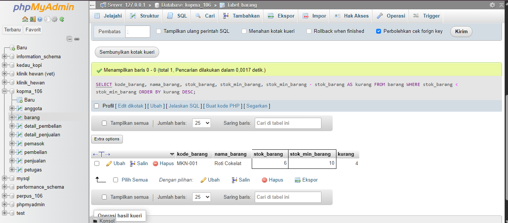
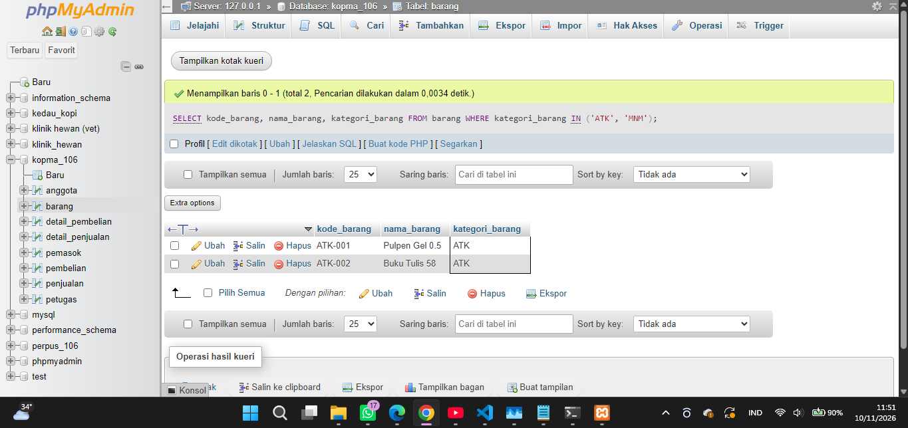
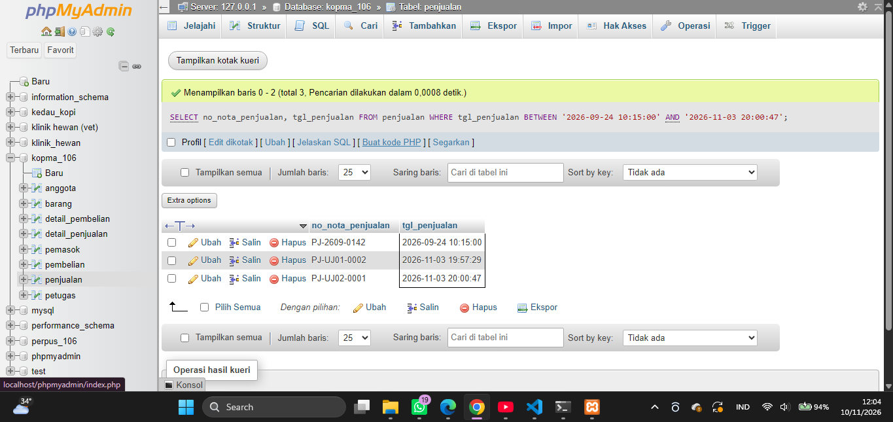
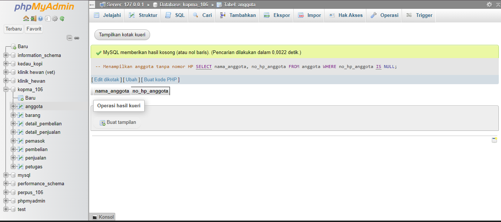
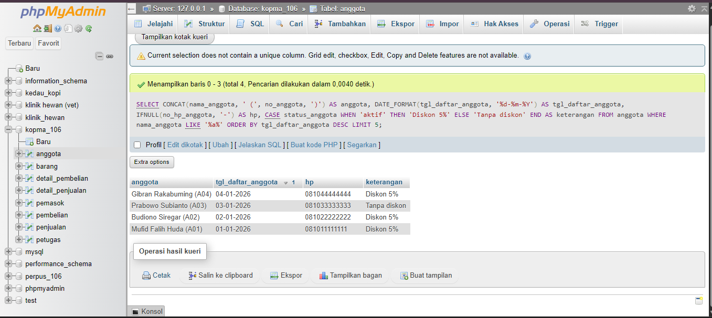
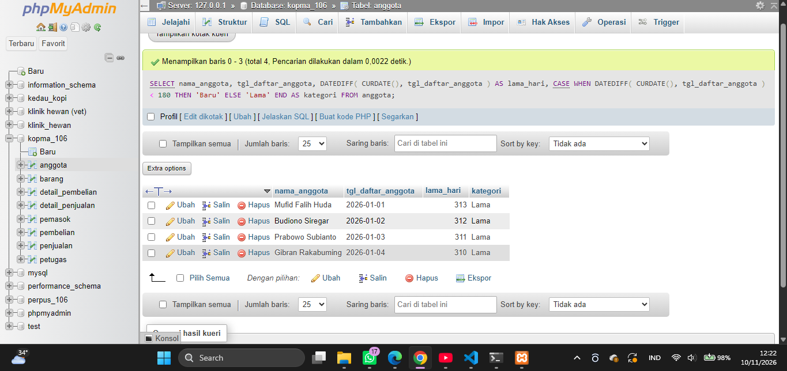
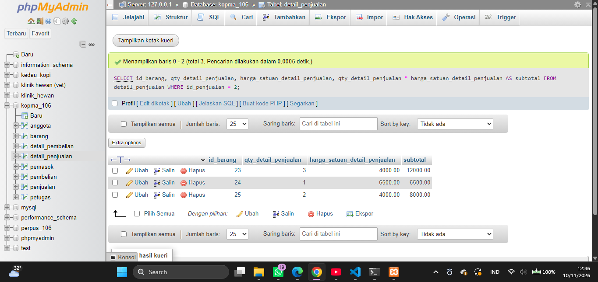
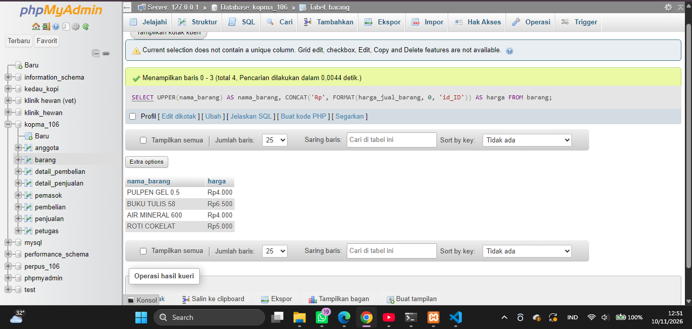
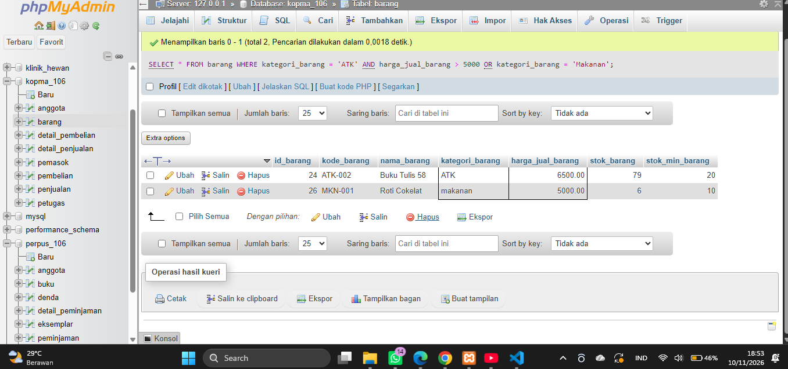
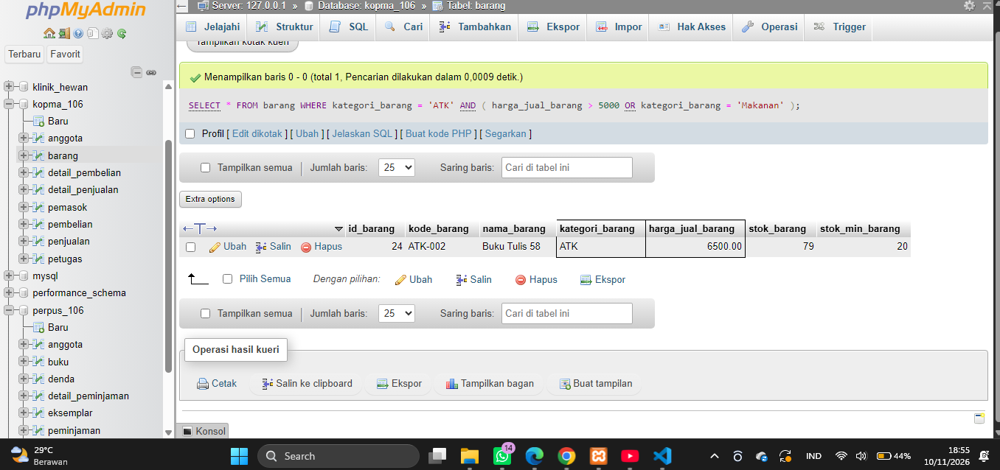

# Laporan Praktikum Basis Data - Pertemuan 04

**Nama:** Mufid Falih Huda 

**NPM:** 25430106 

**Kelas:** D  

**Tanggal:** 11 November 2026

**Dosen:** Dedi Irawan, S.Kom., M.Kom.

---

# 1. Tujuan Praktikum

Setelah melaksanakan praktikum Modul 7, tujuan yang ingin dicapai adalah:

1. Memahami penggunaan perintah `SELECT` untuk mengambil dan menampilkan data dari tabel.
2. Memahami cara menyaring data menggunakan operator pembanding, logika, `BETWEEN`, `IN`, `LIKE`, dan `IS NULL`.
3. Memahami penggunaan `ORDER BY` dan `LIMIT` untuk mengurutkan serta membatasi hasil kueri.
4. Menggunakan fungsi skalar string, tanggal, numerik, dan kondisional untuk menyajikan data sesuai kebutuhan.
5. Membuat kueri yang mendukung kebutuhan informasi (KI) pada proyek basis data Perpustakaan M MEDIA.

# 2. Ringkasan Dasar Teori

Pada Modul 7, materi utama yang dipelajari adalah penggunaan perintah `SELECT` dan fungsi skalar untuk mengambil, menyaring, mengurutkan, serta menyajikan data dari basis data.

Perintah `SELECT` digunakan untuk menentukan kolom yang ingin ditampilkan, sedangkan `FROM` menentukan tabel sumber data. Penyaringan dilakukan menggunakan `WHERE`, pengurutan menggunakan `ORDER BY`, dan pembatasan jumlah baris menggunakan `LIMIT`.

## 2.1 Ringkasan Perintah dan Fungsi SQL

Berikut tabel perintah dan fungsi SQL yang digunakan atau dipelajari selama praktikum Modul 7.

| Perintah/Fungsi | Fungsi | Contoh penggunaan |
|---|---|---|
| `SELECT` | Mengambil dan menampilkan data dari tabel. | `SELECT nama_anggota FROM anggota;` |
| `FROM` | Menentukan tabel sumber data. | `FROM anggota` |
| `WHERE` | Menyaring baris berdasarkan kondisi tertentu. | `WHERE status_anggota = 'aktif'` |
| `AS` | Memberikan nama alias pada kolom atau hasil perhitungan. | `nama_anggota AS nama` |
| `DISTINCT` | Menghilangkan data duplikat pada hasil kueri. | `SELECT DISTINCT kategori_buku FROM buku;` |
| `AND` | Menggabungkan kondisi yang semuanya harus terpenuhi. | `WHERE status_anggota = 'aktif' AND no_hp_anggota IS NOT NULL` |
| `OR` | Menggabungkan kondisi yang salah satunya dapat terpenuhi. | `WHERE kategori_buku = 'Novel' OR kategori_buku = 'Komik'` |
| `IN` | Memeriksa apakah nilai termasuk dalam beberapa pilihan. | `WHERE status_eksemplar IN ('tersedia', 'dipinjam')` |
| `BETWEEN` | Menyaring nilai dalam rentang tertentu. | `WHERE tahun_terbit BETWEEN 2020 AND 2026` |
| `LIKE` | Mencari data berdasarkan pola teks. | `WHERE nama_anggota LIKE '%a%'` |
| `IS NULL` | Mencari kolom yang tidak memiliki nilai atau bernilai NULL. | `WHERE no_hp_anggota IS NULL` |
| `ORDER BY` | Mengurutkan hasil kueri. | `ORDER BY nama_anggota ASC` |
| `ASC` | Mengurutkan data dari kecil ke besar atau A–Z. | `ORDER BY nama_anggota ASC` |
| `DESC` | Mengurutkan data dari besar ke kecil atau Z–A. | `ORDER BY tanggal_daftar DESC` |
| `LIMIT` | Membatasi jumlah baris yang ditampilkan. | `LIMIT 5` |
| `CONCAT()` | Menggabungkan beberapa teks menjadi satu. | `CONCAT(nama_anggota, ' (', no_anggota, ')')` |
| `UPPER()` | Mengubah teks menjadi huruf kapital. | `UPPER(judul_buku)` |
| `LEFT()` | Mengambil beberapa karakter dari sebelah kiri teks. | `LEFT(judul_buku, 5)` |
| `LENGTH()` | Menghitung panjang teks dalam satuan byte. | `LENGTH(nama_anggota)` |
| `DATE_FORMAT()` | Mengubah tampilan tanggal sesuai format yang ditentukan. | `DATE_FORMAT(tanggal_daftar, '%d-%m-%Y')` |
| `DATEDIFF()` | Menghitung selisih hari antara dua tanggal. | `DATEDIFF(CURDATE(), tanggal_daftar)` |
| `CURDATE()` | Mengambil tanggal hari ini. | `CURDATE()` |
| `YEAR()` | Mengambil bagian tahun dari sebuah tanggal. | `YEAR(tanggal_pengembalian)` |
| `ROUND()` | Membulatkan angka sesuai jumlah desimal yang ditentukan. | `ROUND(1250.75, 0)` |
| `FLOOR()` | Membulatkan angka ke bawah. | `FLOOR(12.8)` |
| `ABS()` | Menghasilkan nilai absolut atau nilai positif dari angka. | `ABS(-10)` |
| `FORMAT()` | Memformat angka dengan pemisah ribuan dan jumlah desimal tertentu. | `FORMAT(4000, 0, 'id_ID')` |
| `IF()` | Menghasilkan nilai berdasarkan kondisi benar atau salah. | `IF(hari_terlambat > 0, 'Terlambat', 'Tepat waktu')` |
| `IFNULL()` | Mengganti nilai NULL dengan nilai pengganti. | `IFNULL(no_hp_anggota, '-')` |
| `CASE` | Memberikan hasil berbeda berdasarkan beberapa kondisi. | `CASE WHEN status_anggota = 'aktif' THEN 'Aktif' ELSE 'Nonaktif' END` |

## 2.2 Urutan Evaluasi SELECT

Walaupun perintah SQL ditulis dengan urutan `SELECT`, `FROM`, `WHERE`, `ORDER BY`, dan `LIMIT`, proses evaluasinya secara logis memiliki urutan berbeda.

Urutan evaluasi secara sederhana:

1. `FROM`: menentukan tabel sumber data.
2. `WHERE`: menyaring baris sesuai kondisi.
3. `SELECT`: menentukan kolom dan ekspresi yang ditampilkan.
4. `ORDER BY`: mengurutkan hasil.
5. `LIMIT`: membatasi jumlah hasil.

Hal ini menjelaskan mengapa alias yang dibuat pada bagian `SELECT` belum dapat digunakan secara langsung pada `WHERE`.

# 3. Hasil Langkah Percobaan 

Pada bagian ini dilakukan percobaan penggunaan perintah `SELECT`, penyaringan data, pengurutan, pembatasan hasil, serta fungsi skalar sesuai langkah-langkah pada Modul 7.

## 3.1 D.1 Proyeksi dan Penyaringan
### Langkah 1. Menampilkan barang yang perlu dipesan ulang

```sql
SELECT
    kode_barang,
    nama_barang,
    stok_barang,
    stok_min_barang,
    stok_min_barang - stok_barang AS kurang
FROM barang
WHERE stok_barang < stok_min_barang
ORDER BY kurang DESC;
```

**Penjelasan:**

- `SELECT` menentukan kolom yang ditampilkan.
- `stok_min_barang - stok_barang` menghitung jumlah kekurangan stok.
- `AS kurang` memberikan nama alias pada hasil perhitungan.
- `WHERE` menyaring barang yang stoknya lebih kecil daripada stok minimum.
- `ORDER BY kurang DESC` mengurutkan barang berdasarkan jumlah kekurangan stok dari yang terbesar.

**Hasil :** Barang yang stoknya berada di bawah batas minimum ditampilkan, dimulai dari barang dengan kekurangan stok paling besar.



### Langkah 2. Membuat tiga kueri penyaringan lainnya

Pada langkah ini dilakukan penyaringan data menggunakan `IN`, `BETWEEN`, dan `IS NULL`.

**a. Menggunakan IN**

Kueri digunakan untuk menampilkan barang dengan kategori tertentu, misalnya ATK atau minuman.
```sql
SELECT kode_barang, nama_barang, kategori_barang
FROM barang
WHERE kategori_barang IN ('ATK', 'MNM');
```


**Hasil :** Hanya barang yang kategorinya ATK atau Minuman yang ditampilkan.

**b. Menggunakan BETWEEN**

Kueri digunakan untuk menampilkan nota dalam rentang tanggal tertentu.
```sql
SELECT no_nota_penjualan, tgl_penjualan
FROM penjualan
WHERE tgl_penjualan
BETWEEN '2026-09-24 10:15:00' AND '2026-11-03 20:00:47';
```


**Hasil :** Nota yang tanggal penjualannya berada pada rentang 1 sampai 30 September 2026 ditampilkan.

**c. Menggunakan IS NULL**

Kueri digunakan untuk mencari anggota yang belum mengisi nomor HP.
```sql
SELECT nama_anggota, no_hp_anggota
FROM anggota
WHERE no_hp_anggota IS NULL;
```


**Hasil :** Hanya anggota yang nomor HP-nya bernilai NULL yang ditampilkan.

`DISINI KSONG KARENA DI DATABASE TIDAK ADA ANGGOTA YANG TIDAK MEMPUNYAI NOMOR HP YANG KOSONG.`

## 3.2 D.2 Pola Teks dan Nilai Kosong

### Langkah 3. Menampilkan data anggota dengan format yang mudah dibaca

Pada langkah ini digunakan beberapa fungsi skalar untuk mengolah teks, tanggal, nilai kosong, dan kondisi status anggota.

```sql
SELECT
    CONCAT(nama_anggota, ' (', no_anggota, ')') AS anggota,
    DATE_FORMAT(tgl_daftar_anggota, '%d-%m-%Y') AS tgl_daftar_anggota,
    IFNULL(no_hp_anggota, '-') AS hp,
    CASE status_anggota
        WHEN 'aktif' THEN 'Diskon 5%'
        ELSE 'Tanpa diskon'
    END AS keterangan
FROM anggota
WHERE nama_anggota LIKE '%a%'
ORDER BY tgl_daftar_anggota DESC
LIMIT 5;
```
**Penjelasan fungsi:**

- `CONCAT()` menggabungkan nama anggota dengan nomor anggota.
- `DATE_FORMAT()` mengubah format tanggal menjadi hari-bulan-tahun.
- `IFNULL()` mengganti nomor HP yang bernilai NULL dengan tanda strip.
- `CASE` memberikan keterangan berdasarkan status anggota.
- `LIKE '%a%'` mencari nama anggota yang mengandung huruf a.
- `ORDER BY ... DESC` mengurutkan tanggal pendaftaran dari terbaru.
- `LIMIT 5` membatasi hasil menjadi maksimal lima baris.

**Hasil :** Data anggota yang namanya mengandung huruf a ditampilkan dengan format lebih mudah dibaca dan maksimal lima baris.

**Bukti tangkapan layar:**


## 3.3 D.3 Tanggal dan Perhitungan per Baris
### Langkah 4. Menghitung lama keanggotaan

Kueri digunakan untuk menghitung lama keanggotaan setiap anggota dalam satuan hari.
```sql
SELECT
    nama_anggota,
    tgl_daftar_anggota,
    DATEDIFF(
        CURDATE(),
        tgl_daftar_anggota
    ) AS lama_hari,
    CASE
        WHEN DATEDIFF(
            CURDATE(),
            tgl_daftar_anggota
        ) < 180 THEN 'Baru'
        ELSE 'Lama'
    END AS kategori
FROM anggota;
```

**Penjelasan:**

- `CURDATE()` mengambil tanggal hari ini.
- `DATEDIFF()` menghitung selisih hari antara tanggal hari ini dan tanggal pendaftaran.
- `CASE` membedakan anggota baru dan lama.
- Anggota dengan lama keanggotaan kurang dari 180 hari dikategorikan sebagai baru, sedangkan sisanya dikategorikan sebagai lama.

**Hasil :** Setiap anggota ditampilkan bersama lama keanggotaannya dan kategori baru atau lama.

**Bukti tangkapan layar:**


### Langkah 5. Menghitung subtotal setiap detail nota

Pada langkah ini dilakukan perhitungan subtotal untuk setiap barang yang terdapat dalam nota `PJ-2609-0142`.

```sql
SELECT id_barang,
       qty_detail_penjualan,
       harga_satuan_detail_penjualan,
       qty_detail_penjualan * harga_satuan_detail_penjualan AS subtotal
FROM detail_penjualan
WHERE id_penjualan = 2;
```

**Penjelasan:**
- `qty_detail_penjualan` = jumlah barang yang dibeli.
- `harga_satuan_detail_penjualan` = harga satuan barang.
- `AS subtotal` = memberi nama hasil perkalian.
- CATATAN: Angka `2` merupakan id_penjualan yang sesuai dengan nota `PJ-2609-0142`.

**Hasil :** Setiap detail barang pada nota ditampilkan beserta jumlah, harga satuan, dan subtotalnya.

**Bukti tangkapan layar:**


# 4. Jawaban Titik Analisis

## 4.1 Titik Analisis 1: Penggunaan Alias pada WHERE

**Pertanyaan:** Mengapa ketika `ORDER BY kurang` diganti menjadi `WHERE kurang > 0`, muncul galat? Bagaimana menulis kondisi yang setara tanpa menggunakan alias?

**Jawaban:**

Galat muncul karena alias `kurang` dibuat pada bagian `SELECT`, sedangkan `WHERE` dievaluasi lebih dahulu. Akibatnya, ketika bagian `WHERE` diproses, alias tersebut belum dikenali oleh MariaDB.

Kueri yang menggunakan alias pada `WHERE`:

```sql
SELECT
    stok_min_barang - stok_barang AS kurang
FROM barang
WHERE kurang > 0;
```

Kueri tersebut dapat menghasilkan galat karena alias `kurang` belum tersedia ketika kondisi `WHERE` diperiksa.

Perbaikannya adalah menuliskan kembali ekspresi perhitungannya secara langsung:

```sql
SELECT
    stok_min_barang - stok_barang AS kurang
FROM barang
WHERE stok_min_barang - stok_barang > 0;
```

**Kesimpulan:** Alias dapat digunakan pada bagian seperti `ORDER BY`, tetapi tidak dapat digunakan secara langsung pada `WHERE` dalam kueri yang sama karena urutan evaluasi SQL.

## 4.2 Titik Analisis 2: Perbedaan NULL dan String Kosong

**Pertanyaan:** Mengapa `WHERE no_hp_anggota = NULL` tidak pernah mengembalikan baris, padahal terdapat anggota yang belum mengisi nomor HP?

**Jawaban:**

`NULL` menunjukkan bahwa suatu kolom tidak memiliki nilai atau nilainya belum diketahui. Karena itu, NULL tidak dapat diperiksa menggunakan operator sama dengan (`=`).

Kueri yang salah:

```sql
SELECT *
FROM anggota
WHERE no_hp_anggota = NULL;
```

Kueri yang benar:

```sql
SELECT *
FROM anggota
WHERE no_hp_anggota IS NULL;
```

Perbedaan NULL dengan string kosong (`''`) adalah sebagai berikut:

| NULL | String kosong ('') |
|---|---|
| Tidak memiliki nilai atau belum diketahui. | Memiliki nilai berupa teks kosong. |
| Diperiksa menggunakan `IS NULL`. | Diperiksa menggunakan `= ''`. |
| Bukan teks kosong. | Merupakan nilai teks dengan panjang nol. |

**Kesimpulan:** Untuk mencari data yang belum memiliki nomor HP, kondisi yang tepat adalah `IS NULL`, bukan `= NULL`.

## 4.3 Titik Analisis 3: Perhitungan Subtotal dan Total Nota

**Pertanyaan:** Subtotal setiap baris dapat dihitung pada Modul 7, tetapi total nota belum. Mengapa? Fitur SQL apa yang dibutuhkan untuk menjumlahkan banyak baris menjadi satu nilai?

**Jawaban:**

Pada Modul 7, perhitungan dilakukan menggunakan operasi perkalian antara jumlah barang dan harga satuan. Hasilnya adalah subtotal untuk setiap baris detail transaksi.

Namun, satu nota dapat memiliki beberapa baris detail. Untuk menjumlahkan seluruh subtotal tersebut menjadi satu nilai total nota, diperlukan fungsi agregat `SUM()`.

Contoh konsep perhitungannya:

```sql
SELECT
    SUM(qty_detail_penjualan * harga_satuan_detail_penjualan) AS total_nota
FROM detail_penjualan;
```

**Kesimpulan:** Perhitungan subtotal menghasilkan nilai untuk setiap baris, sedangkan `SUM()` digunakan untuk menjumlahkan banyak baris menjadi satu nilai. Fungsi agregat ini akan dipelajari lebih lanjut pada Pertemuan 9.

# 5. Hasil Latihan dan Modifikasi

## 5.1 Latihan 1: Menampilkan Nama Barang Huruf Kapital dan Harga Rupiah

Pada latihan pertama, dilakukan pengubahan nama barang menjadi huruf kapital dan pemformatan harga agar tampil menggunakan format Rupiah.

Kueri yang digunakan:

```sql
SELECT
    UPPER(nama_barang) AS nama_barang,
    CONCAT('Rp', FORMAT(harga_jual_barang, 0, 'id_ID')) AS harga
FROM barang;
```
**Penjelasan:**
- `UPPER()` mengubah nama barang menjadi huruf kapital.
- `FORMAT()` mengatur angka dengan pemisah ribuan sesuai format Indonesia.
- `CONCAT()` menggabungkan teks `Rp` dengan hasil pemformatan harga.

**Hasil :** Nama barang ditampilkan menggunakan huruf kapital, sedangkan harga ditampilkan dengan format seperti `Rp4.000`.

**Bukti tangkapan layar:**



## 5.2 Latihan 2: Kesalahan Semantik dan Perbaikannya

**Pertanyaan:** Bagaimana menampilkan barang kategori ATK atau Minuman yang stoknya berada di bawah stok minimum?

### Kueri yang salah secara semantik

```sql
SELECT *
FROM barang
WHERE kategori_barang = 'ATK'
  AND harga_jual_barang > 5000
   OR kategori_barang = 'Makanan';
```

**Mengapa salah?**

SQL memproses operator `AND` lebih dahulu daripada `OR`. Akibatnya, seluruh barang kategori ATK dapat ikut ditampilkan meskipun stoknya tidak berada di bawah stok minimum.

### Kueri yang sudah diperbaiki
```sql
SELECT *
FROM barang
WHERE kategori_barang = 'ATK'
  AND (
      harga_jual_barang > 5000
      OR kategori_barang = 'Makanan'
  );
```
**Penjelasan perbaikan:** Tanda kurung digunakan untuk mengelompokkan kondisi kategori ATK atau Minuman terlebih dahulu. Setelah itu, kondisi stok di bawah minimum diterapkan pada kedua kategori tersebut.

**Hasil yang diharapkan:** Hanya barang kategori ATK atau Minuman yang stoknya berada di bawah stok minimum yang ditampilkan.

**Bukti tangkapan layar wajib:**

- 
- 

# 6. Tugas Mandiri: Milestone Proyek 7

Pada tugas mandiri ini, kueri SQL dibuat berdasarkan kebutuhan informasi pada proyek **Perpustakaan M MEDIA** dengan database `perpus_106`.

File yang dibuat adalah:

`p07_kueri_25430106.sql`

File tersebut berisi 11 kueri yang menggunakan satu tabel pada setiap kueri. Setiap kueri dilengkapi komentar berisi kode KI, pertanyaan dalam bahasa sehari-hari, dan hasil yang diharapkan.

## 6.1 Pemetaan Kueri terhadap Kebutuhan Informasi

Berikut pemetaan kueri yang dibuat terhadap kebutuhan informasi proyek.

| No. | Kueri | Tabel | KI | Fungsi/operator |
|---|---|---|---|---|
| 1 | Menampilkan daftar anggota aktif. | anggota | KI-01 | `WHERE` |
| 2 | Mencari anggota berdasarkan huruf pada nama. | anggota | KI-01 | `LIKE` |
| 3 | Menampilkan anggota tanpa nomor HP. | anggota | KI-01 | `IS NULL` |
| 4 | Memberikan keterangan status anggota. | anggota | KI-01 | `CASE` |
| 5 | Menampilkan judul buku dengan huruf kapital. | buku | KI-02 | `UPPER()` dan `LIKE` |
| 6 | Menampilkan eksemplar dengan status tertentu. | eksemplar | KI-02 | `IN` |
| 7 | Menampilkan detail transaksi peminjaman. | detail_peminjaman | KI-03 | `SELECT` |
| 8 | Menampilkan transaksi peminjaman selama tahun 2026. | peminjaman | KI-04 | `BETWEEN` |
| 9 | Menghitung jumlah hari sejak batas pengembalian. | peminjaman | KI-04 | `DATEDIFF()` dan `CURDATE()` |
| 10 | Menampilkan pengembalian selama tahun 2026. | pengembalian | KI-05 | `YEAR()` |
| 11 | Memberikan keterangan keterlambatan denda. | denda | KI-04 | `CASE` |

### 6.2 Penjelasan Kueri Proyek

Kueri proyek dibuat untuk membantu menjawab kebutuhan informasi pada sistem Perpustakaan M MEDIA. Setiap kueri disesuaikan dengan Kebutuhan Informasi (KI) yang telah ditentukan.

**1. KI-01 – Informasi Anggota Perpustakaan**

KI-01 digunakan untuk mengetahui informasi anggota, seperti anggota yang masih aktif, pencarian anggota berdasarkan nama, anggota yang belum mengisi nomor HP, serta keterangan status anggota.

**a. Menampilkan anggota aktif**

```sql
SELECT no_anggota, nim_anggota, nama_anggota, status_anggota
FROM anggota
WHERE status_anggota = 'aktif';
```

Kueri ini menampilkan nomor anggota, NIM, nama, dan status anggota yang masih aktif.

**b. Mencari anggota berdasarkan nama**

```sql
SELECT no_anggota, nama_anggota, nim_anggota
FROM anggota
WHERE nama_anggota LIKE '%a%';
```

Kueri ini mencari anggota yang namanya mengandung huruf 'a' menggunakan operator `LIKE`.

**c. Menampilkan anggota tanpa nomor HP**

```sql
SELECT no_anggota, nama_anggota, no_hp_anggota
FROM anggota
WHERE no_hp_anggota IS NULL;
```

Kueri ini menampilkan anggota yang belum mengisi nomor HP atau memiliki nilai `NULL`.

**d. Menampilkan keterangan status anggota**

```sql
SELECT no_anggota, nama_anggota,
       CASE
           WHEN status_anggota = 'aktif' THEN 'Aktif'
           ELSE 'Nonaktif'
       END AS keterangan_status
FROM anggota;
```

Kueri ini menggunakan fungsi `CASE` untuk mengubah status anggota menjadi keterangan 'Aktif' atau 'Nonaktif'.

**2. KI-02 – Informasi Buku dan Eksemplar**

KI-02 digunakan untuk mencari buku berdasarkan judul dan menampilkan eksemplar berdasarkan status ketersediaannya.

**a. Mencari buku berdasarkan judul**

```sql
SELECT kode_buku, UPPER(judul_buku) AS judul_buku,
       penulis_buku, kategori_buku
FROM buku
WHERE judul_buku LIKE '%basis%';
```

Kueri ini mencari buku yang judulnya mengandung kata 'basis'. Fungsi `UPPER()` digunakan agar judul buku ditampilkan menggunakan huruf kapital.

**b. Menampilkan eksemplar berdasarkan status**

```sql
SELECT kode_eksemplar, id_buku, status_eksemplar
FROM eksemplar
WHERE status_eksemplar IN ('tersedia', 'dipinjam');
```

Kueri ini menampilkan eksemplar yang memiliki status tersedia atau sedang dipinjam menggunakan operator `IN`.

**3. KI-03 – Informasi Detail Peminjaman**

KI-03 digunakan untuk mengetahui eksemplar yang tercatat dalam transaksi peminjaman.

```sql
SELECT no_peminjaman, kode_eksemplar
FROM detail_peminjaman;
```

Kueri ini menampilkan nomor peminjaman dan kode eksemplar yang tercatat pada tabel detail peminjaman. Namun, kueri ini belum dapat memastikan apakah eksemplar masih dipinjam atau sudah dikembalikan karena membutuhkan tabel pengembalian.

**4. KI-04 – Informasi Peminjaman dan Keterlambatan**

KI-04 digunakan untuk mengetahui transaksi peminjaman berdasarkan periode tanggal serta mencari peminjaman yang batas pengembaliannya sudah terlewati.

**a. Menampilkan peminjaman selama tahun 2026**

```sql
SELECT no_peminjaman, id_anggota,
       tanggal_peminjaman, batas_pengembalian
FROM peminjaman
WHERE tanggal_peminjaman
BETWEEN '2026-01-01' AND '2026-12-31';
```

Kueri ini menampilkan transaksi peminjaman yang terjadi selama tahun 2026 menggunakan operator `BETWEEN`.

**b. Menampilkan calon peminjaman terlambat**

```sql
SELECT no_peminjaman, id_anggota, batas_pengembalian,
       DATEDIFF(CURDATE(), batas_pengembalian) AS hari_sejak_batas
FROM peminjaman
WHERE batas_pengembalian < CURDATE();
```

Kueri ini menampilkan peminjaman yang batas pengembaliannya sudah melewati tanggal hari ini. Fungsi `DATEDIFF()` menghitung selisih hari, sedangkan `CURDATE()` mengambil tanggal saat ini. Hasilnya masih berupa calon keterlambatan karena perlu diperiksa dengan data pengembalian.

**5. KI-05 – Informasi Pengembalian**

KI-05 digunakan untuk mengetahui data pengembalian buku berdasarkan periode tertentu.

```sql
SELECT no_pengembalian, no_peminjaman,
       kode_eksemplar, tanggal_pengembalian
FROM pengembalian
WHERE YEAR(tanggal_pengembalian) = 2026;
```

Kueri ini menampilkan nomor pengembalian, nomor peminjaman, kode eksemplar, dan tanggal pengembalian selama tahun 2026. Fungsi `YEAR()` digunakan untuk mengambil tahun dari tanggal pengembalian.

**6. KI-04 – Informasi Keterangan Denda**

Kueri tambahan untuk KI-04 digunakan untuk menampilkan jumlah denda dan keterangan keterlambatan pada setiap data denda.

```sql
SELECT no_denda, no_pengembalian,
       hari_terlambat, jumlah_denda,
       CASE
           WHEN hari_terlambat > 0 THEN 'Terlambat'
           ELSE 'Tidak terlambat'
       END AS keterangan
FROM denda;
```

Kueri ini menggunakan `CASE` untuk memberikan keterangan berdasarkan jumlah hari keterlambatan. Jika jumlah hari terlambat lebih dari 0, maka keterangannya 'Terlambat'. Jika tidak, keterangannya 'Tidak terlambat'.

**Kesimpulan Penjelasan Kueri**

Berdasarkan kueri yang dibuat, KI-01 sampai KI-05 telah memiliki kueri awal untuk menampilkan informasi yang dibutuhkan. Beberapa kebutuhan informasi masih memerlukan penggabungan tabel atau fungsi agregat agar dapat dijawab secara lengkap. Hal tersebut akan dilanjutkan pada pertemuan berikutnya.


## 6.3 Analisis Keterbatasan Kebutuhan Informasi

Tidak semua kebutuhan informasi dapat dijawab menggunakan satu tabel. Hal ini disebabkan beberapa informasi membutuhkan data yang berasal dari tabel berbeda.

| Kode KI | Kebutuhan informasi | Status | Alasan |
|---|---|---|---|
| KI-01 | Daftar anggota aktif. | Dapat dijawab | Data status anggota tersedia langsung pada tabel anggota. |
| KI-02 | Ketersediaan buku. | Belum sepenuhnya | Membutuhkan hubungan tabel buku dan eksemplar untuk menampilkan judul sekaligus status setiap eksemplar. |
| KI-03 | Daftar buku yang sedang dipinjam. | Belum sepenuhnya | Membutuhkan tabel detail_peminjaman dan pengembalian untuk mengetahui apakah eksemplar sudah dikembalikan. |
| KI-04 | Daftar anggota yang terlambat. | Belum sepenuhnya | Membutuhkan hubungan anggota, peminjaman, dan pengembalian untuk memastikan anggota yang benar-benar terlambat. |
| KI-05 | Jumlah peminjaman dan pengembalian per periode. | Belum dapat dijawab sepenuhnya | Membutuhkan fungsi agregat seperti `COUNT()` dan pengelompokan `GROUP BY`. |

**Kesimpulan analisis:** Kueri satu tabel dapat menjawab sebagian kebutuhan informasi proyek. Namun, informasi yang membutuhkan hubungan antartabel dan perhitungan agregat akan dilanjutkan pada Pertemuan 9–12 sesuai materi berikutnya.

# 7. Pembahasan dan Kendala

Berdasarkan praktikum Modul 7, penggunaan `SELECT` tidak hanya bertujuan menampilkan seluruh data, tetapi juga membantu mengambil informasi tertentu sesuai kebutuhan pengguna.

Penggunaan operator penyaringan seperti `LIKE`, `BETWEEN`, `IN`, dan `IS NULL` membuat pencarian data menjadi lebih terarah. Selain itu, fungsi skalar seperti `UPPER()`, `CONCAT()`, `DATEDIFF()`, `IFNULL()`, dan `CASE` membantu menyajikan data dengan format yang lebih mudah dipahami.

Dalam pengerjaan praktikum terdapat beberapa hal yang perlu diperhatikan.

| No. | Kendala atau hal yang diperhatikan | Penyelesaian |
|---|---|---|
| 1 | Alias tidak dapat digunakan secara langsung pada `WHERE`. | Menuliskan kembali ekspresi perhitungan pada kondisi `WHERE`. |
| 2 | Penggunaan `= NULL` tidak menghasilkan pencarian yang benar. | Menggunakan `IS NULL` untuk memeriksa nilai NULL. |
| 3 | Kolom nomor nota tidak tersedia pada tabel detail penjualan. | Menghubungkan tabel detail_penjualan dengan penjualan menggunakan `JOIN` dan `id_penjualan`. |
| 4 | Kondisi `AND` dan `OR` dapat menghasilkan data yang tidak sesuai jika tidak dikelompokkan. | Menggunakan tanda kurung untuk memperjelas prioritas kondisi. |
| 5 | Beberapa kebutuhan informasi proyek tidak dapat dijawab menggunakan satu tabel. | Menandai KI yang membutuhkan hubungan antartabel atau fungsi agregat untuk dikerjakan pada pertemuan berikutnya. |

# 8. Kesimpulan

Berdasarkan praktikum Modul 7, dapat disimpulkan bahwa perintah `SELECT` digunakan untuk mengambil dan menyajikan data dari basis data sesuai kebutuhan informasi.

Penggunaan operator seperti `WHERE`, `LIKE`, `BETWEEN`, `IN`, dan `IS NULL` membantu melakukan penyaringan data. Sementara itu, `ORDER BY` dan `LIMIT` digunakan untuk mengatur urutan serta jumlah hasil yang ditampilkan.

Fungsi skalar seperti `CONCAT()`, `UPPER()`, `DATE_FORMAT()`, `DATEDIFF()`, `IFNULL()`, dan `CASE` juga membantu mengolah data agar lebih mudah dibaca dan dipahami.

# 9. Pernyataan Penggunaan AI

Dalam pengerjaan praktikum Modul 7, ChatGPT digunakan sebagai alat bantu untuk memahami materi, menjelaskan fungsi perintah SQL, membantu menyusun contoh kueri, serta merapikan dokumentasi laporan.

Setiap kueri tetap perlu diperiksa dan dijalankan kembali pada database `perpus_106` agar sesuai dengan struktur tabel dan data proyek yang digunakan. Hasil akhir laporan disesuaikan berdasarkan hasil praktikum yang sebenarnya.

# 10. Bukti Git (Tautan Repositori + Hash Commit)

Setelah file SQL dan laporan selesai diperiksa, perubahan disimpan dan dikirim ke repositori GitHub.

**Nama berkas yang dikumpulkan:**

| No. | Nama berkas | Hash | Pesan Commit |
|---|---|---|---|
| 1 | `p07_kueri_25430106.sql` | 7085b7c | p07 kueri database perpus |  
| 2 | `p07_kueri_kopma_25430106.sql` | 879fc29 | p07: kueri kopma + latihan modifikasi  |
| 3 | `p07_kueri_kopma_25430106.sql` | 709a863 | p07: kueri kopma |
  
**Tautan repositori GitHub:** [Masukkan tautan repositori]
# Checklist

## Checklist Umum Laporan Praktikum

| No. | Butir | Status |
|---|---|---|
| 1 | Identitas nama, NIM, kelas, pertemuan, tanggal, dan asisten/dosen. | [ ✔ ] |
| 2 | Tujuan praktikum ditulis dengan bahasa sendiri. | [ ✔ ] |
| 3 | Ringkasan teori maksimal setengah halaman. | [ ✔ ] |
| 4 | Langkah percobaan dilengkapi screenshot dan keterangan. | [ ✔ ] |
| 5 | Semua Titik Analisis dijawab dengan alasan. | [ ✔ ] |
| 6 | Latihan dan modifikasi dilengkapi skrip serta bukti hasil. | [ ✔ ] |
| 7 | Tugas mandiri dilengkapi berkas, bukti, dan penjelasan. | [ ✔ ] |
| 8 | Pembahasan dan kendala dituliskan. | [ ✔ ] |
| 9 | Kesimpulan dituliskan. | [ ✔ ] |
| 10 | Pernyataan penggunaan AI dicantumkan. | [ ✔ ] |
| 11 | Bukti Git berupa tautan repositori dan hash commit dicantumkan. | [ ✔ ] |

## Checklist Khusus Laporan Pertemuan 7

| No. | Jenis | Yang harus ada | Status |
|---|---|---|---|
| 1 | Berkas wajib | `p07_kueri_25430106.sql` berisi minimal 10 kueri satu tabel, masing-masing diberi komentar KI dan hasil yang diharapkan. | [ ✔ ] |
| 2 | Bukti tangkapan layar | Hasil setiap kueri. | [ ✔ ] |
| 3 | Analisis wajib | Pemetaan kueri terhadap KI dan alasan pemilihan fungsi skalar yang digunakan. | [ ✔ ] |
